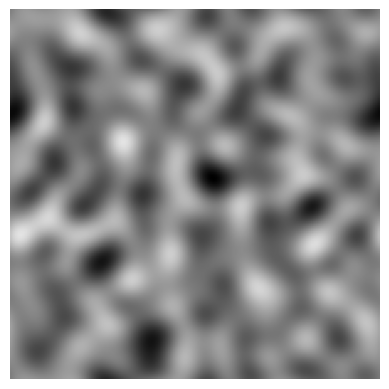
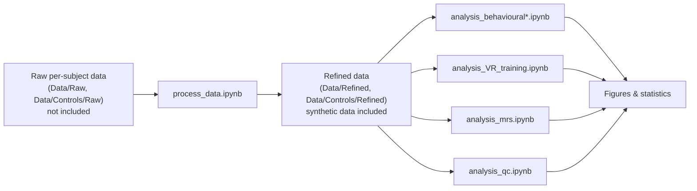

# Amblyopia Plasticity Analysis

[](LICENSE)
[](https://www.python.org/)

Analysis code for a study of visual plasticity in amblyopia ("lazy eye"),
combining psychophysics, VR-based perceptual training, MR spectroscopy (MRS),
and population receptive field (pRF) mapping.

<p align="center">
  
  
</p>
<p align="center"><em>Example psychophysics stimuli generated by <code>side_figures.ipynb</code>: Gabor patches (left) and band-limited noise (right).</em></p>

## Pipeline



`side_figures.ipynb` sits outside this pipeline — it generates standalone
illustration figures rather than analysing study data.

## Repository structure

```
Analysis/
  import_packages.py                       shared imports, loaded by every notebook
  BV_processing.py                         behavioural/psychophysics processing & plotting
  MRS_processing.py                        MR spectroscopy (GABA+, Glx, etc.) processing & plotting
  VR_processing.py                         VR training session processing & plotting
  plot_utils.py                            shared validation/save-or-show helpers
  process_data.ipynb                       raw -> refined data processing pipeline (patients & controls)
  analysis_behavioural.ipynb               psychophysics results (contrast sensitivity, acuity, ...)
  analysis_behavioural_familiarisation.ipynb   same measures for the familiarisation session
  analysis_mrs.ipynb                       MRS (GABA+/Glx) results
  analysis_qc.ipynb                        MRS quality control (linewidth, SNR, CRLB, voxel overlap)
  analysis_VR_training.ipynb               VR training progress/noise analysis
  side_figures.ipynb                       supplementary/illustration figures
  example_figures/                         sample stimulus images used in this README

Data/
  README.md                        details on the synthetic data below
  Refined/, Controls/Refined/      synthetic example data (patient / control groups)
```

## Data

**The data included in this repository is synthetic.** It was generated to
mimic the structure, ranges, and derived quantities of the real study data so
the notebooks can be run and demonstrated without exposing real participant
data (this study is subject to GDPR). See [`Data/README.md`](Data/README.md)
for exactly how it was generated and what it can/can't be used for.

Not every notebook is runnable end-to-end with the included data.
`analysis_behavioural.ipynb`, `analysis_behavioural_familiarisation.ipynb`, and
`analysis_VR_training.ipynb` work out of the box against
`Data/Refined`/`Data/Controls/Refined`. `process_data.ipynb`, `analysis_mrs.ipynb`,
and `analysis_qc.ipynb` additionally expect raw per-subject and MRS files
(`Data/Raw`, `mrs_results_main.xlsx`, `combined_*.csv`, ...) that are derived from
real neuroimaging/clinical data and are **not included**. `side_figures.ipynb`'s
stimulus/schematic figures are self-contained; its brain-mask overlay figures need
external MRI atlas files (see the `<path-to-external-data>` placeholders in that
notebook).

## Setup

```bash
pip install -r requirements.txt
```

Notebooks are meant to be run from inside the `Analysis/` directory (they
resolve data paths as `../Data/...` relative to the notebook's working
directory).

## License

Released under [CC BY 4.0](LICENSE).
